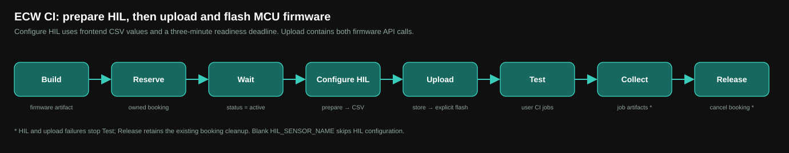

# ECW CI GitHub Actions Templates

A ready-to-copy GitHub Actions pipeline that books a real (or virtual) board
on an ECW backend, flashes your firmware onto it, runs hardware-in-the-loop
CI jobs against it, and releases the booking -- for **any** board, **any**
build process, and **any** set of CI jobs. Nothing in `.github/workflows/`
or `.github/scripts/` is project-specific; everything project-specific
lives in `.github/user/` and your repo's own GitHub config.

```
Build → Reserve → Wait → Configure HIL → Upload + explicit flash → Test → Collect → Release
```



See [docs/](docs/) for the full walkthrough:

| Doc | What it covers |
| --- | --- |
| [docs/01-getting-started.md](docs/01-getting-started.md) | **Start here.** Use this template, add the secret and variable, create jobs, first Arduino run on dev.edgebench.io |
| [docs/02-secrets-and-variables.md](docs/02-secrets-and-variables.md) | Creating an API token, repo secrets, repo variables |
| [docs/03-build-script.md](docs/03-build-script.md) | Writing `.github/user/build/build.sh` for your own project |
| [docs/04-jobs.md](docs/04-jobs.md) | The CI job / command JSON schema, and the payload generator |
| [docs/05-api-reference.md](docs/05-api-reference.md) | The ECW backend endpoints this pipeline calls |
| [docs/06-support-and-liability.md](docs/06-support-and-liability.md) | **Read this** -- what's supported, what's on you |
| [docs/07-trigger-mode.md](docs/07-trigger-mode.md) | **Trigger mode:** ECW wakes your pipeline instead of a runner polling. Full setup and a step-by-step test |
| [docs/08-arduino-demo.md](docs/08-arduino-demo.md) | The bundled Arduino UNO R4 WiFi demo, explained in full |
| [docs/09-wait-mode.md](docs/09-wait-mode.md) | The default pipeline job by job: timeouts, booking reuse, artifacts, failures |
| [docs/10-hil-configuration.md](docs/10-hil-configuration.md) | Configure HIL, frontend-format CSV values, readiness timeout, and upload/flash sequencing |

## Repository layout

```
.github/
  workflows/ci-job-smoke.yml   Wait mode: generic pipeline. Copy as-is; do not edit.
  workflows/ci-job-trigger-stage1.yml   Trigger mode, Stage 1 (build, reserve, register). Copy as-is.
  workflows/ci-job-trigger-stage2.yml   Trigger mode, Stage 2 (claim, flash, test, release). Copy as-is.
  scripts/*.py                 Generic helpers the workflows call. Copy as-is; do not edit.
                               (register_activation_trigger.py is trigger mode only.)
  user/
    build/build.sh              Yours: how your firmware gets built.
    jobs/*.json                 Yours: which CI jobs run against the board.
scripts/
  generate_job_payload.py       Scaffolds a new .github/user/jobs/*.json file.
src/                             Example firmware (Arduino UNO R4 WiFi) -- replace with your own.
docs/                             This documentation, including diagrams.
```

## Branches

- `develop` -- active development of this template.
- `main` -- kept in sync with `develop`; also the branch GitHub's
  `workflow_dispatch` REST API reads workflow *definitions* from, if you
  ever add a session-activation trigger (see the `trigger` branch).
- `trigger` -- this branch: everything on `main` plus the two trigger-mode
  workflows and [docs/07-trigger-mode.md](docs/07-trigger-mode.md). ECW wakes
  your pipeline the moment a booking becomes active, instead of the `Wait`
  job polling for it.

## Quick start

1. Click **Use this template > Create a new repository** on this page (or
   copy `.github/`, `scripts/`, `src/`, and `tests/` into your own repo).
2. Follow [docs/01-getting-started.md](docs/01-getting-started.md): it walks
   through the `ECW_API_KEY` secret, the `BOARD_NAME` variable, the CI job
   files, and your first run on the Arduino UNO R4 WiFi.
3. Want ECW to wake your pipeline instead of a runner polling? Do step 2
   first, then follow [docs/07-trigger-mode.md](docs/07-trigger-mode.md).
   It covers the extra `ECW_DISPATCH_PAT` secret and includes a detailed,
   step-by-step way to test the trigger end to end.

## HIL configuration and firmware upload

Set `HIL_SENSOR_NAME` and place frontend-format CSV values under
`.github/user/hil/`. Configure HIL prepares the approved sensor image, waits
for programming and activation to succeed within three minutes, and sends the CSV values.
The following Upload step stores the MCU firmware and explicitly flashes it;
Test starts only after both operations succeed. Blank `HIL_SENSOR_NAME`
skips the HIL setup. See [the HIL guide](docs/10-hil-configuration.md).

Offline client checks: `python3 -m unittest discover -s tests -v`.
