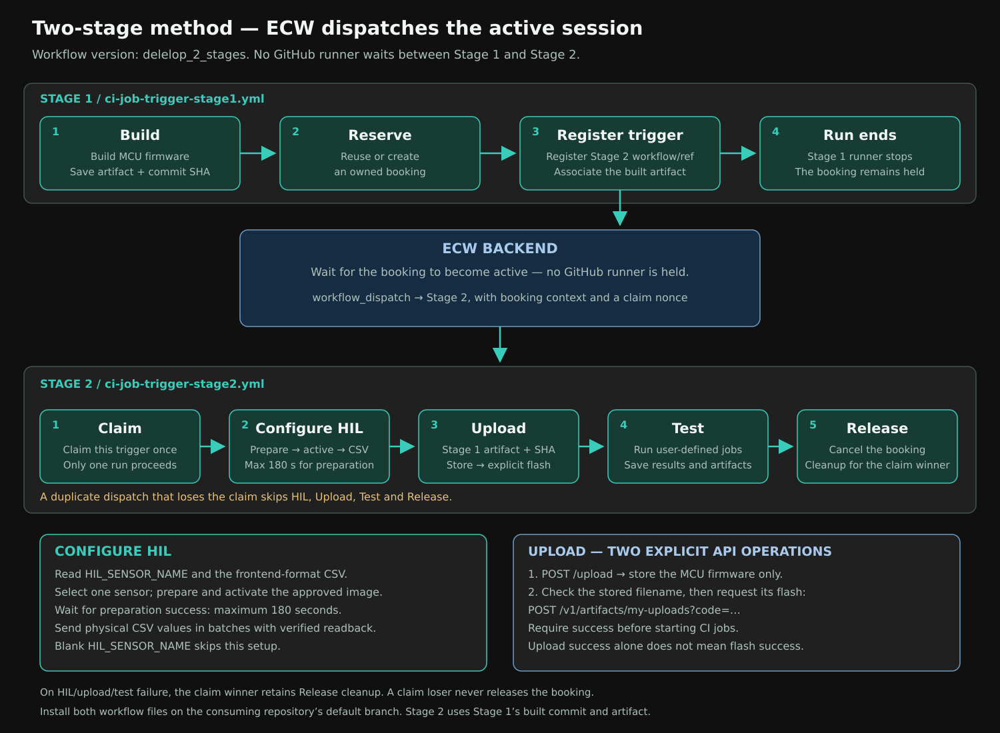

# ECW CI GitHub Actions Templates

A ready-to-copy GitHub Actions pipeline that books a real (or virtual) board
on an ECW backend, flashes your firmware onto it, runs hardware-in-the-loop
CI jobs against it, and releases the booking -- for **any** board, **any**
build process, and **any** set of CI jobs. Nothing in `.github/workflows/`
or `.github/scripts/` is project-specific; everything project-specific
lives in `.github/user/` and your repo's own GitHub config.

```
Build → Reserve → Wait → Configure HIL → Upload + explicit flash → Test → Collect → Release
```

## Single-workflow method

Build, reserve and wait for an active booking in one workflow, then configure
HIL, upload and explicitly flash firmware, run jobs, and release the booking.


## Two-stage method

Stage 1 builds and reserves, registers the activation trigger, then ends.
ECW starts Stage 2 when the booking is active. The claim winner configures
HIL, uploads and flashes firmware, runs jobs, and releases the booking.



Workflow files are on `delelop_2_stages`; follow
[the two-stage setup guide](docs/07-trigger-mode.md).

See [docs/](docs/) for the full walkthrough:

| Doc | What it covers |
| --- | --- |
| [docs/01-getting-started.md](docs/01-getting-started.md) | **Start here.** Use this template, add the secret and variable, create jobs, first Arduino run on dev.edgebench.io |
| [docs/02-secrets-and-variables.md](docs/02-secrets-and-variables.md) | Creating an API token, repo secrets, repo variables |
| [docs/03-build-script.md](docs/03-build-script.md) | Writing `.github/user/build/build.sh` for your own project |
| [docs/04-jobs.md](docs/04-jobs.md) | The CI job / command JSON schema, and the payload generator |
| [docs/05-api-reference.md](docs/05-api-reference.md) | The ECW backend endpoints this pipeline calls |
| [docs/06-support-and-liability.md](docs/06-support-and-liability.md) | **Read this** -- what's supported, what's on you |
| [docs/07-trigger-mode.md](docs/07-trigger-mode.md) | Two-stage setup from `delelop_2_stages`, default-branch requirements and activation claims |
| [docs/08-arduino-demo.md](docs/08-arduino-demo.md) | The bundled Arduino UNO R4 WiFi demo, explained in full |
| [docs/09-wait-mode.md](docs/09-wait-mode.md) | The default pipeline job by job: timeouts, booking reuse, artifacts, failures |
| [docs/10-hil-configuration.md](docs/10-hil-configuration.md) | Configure HIL, frontend-format CSV values, readiness timeout, and upload/flash sequencing |

## Repository layout

```
.github/
  workflows/ci-job-smoke.yml   Generic pipeline. Copy as-is; do not edit.
  scripts/*.py                 Generic helpers the workflow calls. Copy as-is; do not edit.
  user/
    build/build.sh              Yours: how your firmware gets built.
    jobs/*.json                 Yours: which CI jobs run against the board.
    hil/*.csv                   Yours: frontend-format physical HIL values.
scripts/
  generate_job_payload.py       Scaffolds a new .github/user/jobs/*.json file.
src/                             Example firmware (Arduino UNO R4 WiFi) -- replace with your own.
docs/                             This documentation, including diagrams.
tests/                            Offline client checks; no board or API key required.
```

## Branches

- `main` -- the default template, using one workflow with a booking Wait job.
  Documentation for both wait mode and two-stage mode is available here.
- `develop` -- development of the template. Check its workflow triggers when
  choosing which branch to copy.
- `delelop_2_stages` -- the two-stage version, formerly named `trigger`.
  Stage 1 builds and reserves; ECW starts Stage 2 after session activation.
  Stage 2 claims the run, configures HIL, uploads and flashes MCU firmware,
  runs jobs, and releases the booking.

The two-stage workflow files are on `delelop_2_stages`, not on this branch.
Copy them into the default branch of the repository that will run them;
see [the two-stage setup guide](docs/07-trigger-mode.md).

## Quick start

1. Click **Use this template > Create a new repository** on this page (or
   copy `.github/`, `scripts/`, `src/`, and `tests/` into your own repo).
2. Follow [docs/01-getting-started.md](docs/01-getting-started.md): it walks
   through the `ECW_API_KEY` secret, the `BOARD_NAME` variable, the CI job
   files, and your first run on the Arduino UNO R4 WiFi.
3. Want ECW to wake your pipeline instead of a runner polling? See the
   [two-stage setup](docs/07-trigger-mode.md) using `delelop_2_stages`.

## HIL configuration and firmware upload

Set `HIL_SENSOR_NAME` and place frontend-format CSV values under
`.github/user/hil/`. Configure HIL prepares the approved sensor image, waits
for programming and activation to succeed within three minutes, and sends
the CSV values.
The following Upload step stores the MCU firmware and explicitly flashes it;
Test starts only after both operations succeed. Blank `HIL_SENSOR_NAME`
skips the HIL setup. See [the HIL guide](docs/10-hil-configuration.md).

Offline client checks: `python3 -m unittest discover -s tests -v`.

## Configure your repository before running

A template copy does not inherit the source repository's secrets or variables.
Set them under **Settings > Secrets and variables > Actions**:

| Setting | Type | Purpose |
| --- | --- | --- |
| `ECW_API_KEY` | Secret | Token for the chosen ECW environment and booking owner. |
| `BOARD_NAME` | Variable | Board type to book; required. |
| `ECW_BACKEND_URL` | Variable | API base URL for that environment. Production example: `https://www.edgebench.io/api`. |
| `HIL_SENSOR_NAME` | Variable | Exact inventory sensor name. Blank skips HIL configuration. |
| `HIL_CSV_FILE` | Variable, optional | CSV path relative to `.github/user/hil/`; defaults to the selected sensor's example file. |
| `ECW_DISPATCH_PAT` | Secret, two-stage mode | Credential allowing ECW to dispatch Stage 2. |

Use CSV files exported from the frontend; the provided files contain 100
physical-value samples. Configure HIL uses the existing frontend APIs and
waits up to three minutes for preparation/activation success before sending
the CSV. The Upload step then stores the MCU firmware and explicitly flashes
it before jobs start. No new backend route is required.

The selected backend must already expose `/v1/peripheral-prepare` and the
other routes in [the HIL guide](docs/10-hil-configuration.md). An older backend
without this route cannot complete Configure HIL. See
[secrets and variables](docs/02-secrets-and-variables.md) for setup details.
