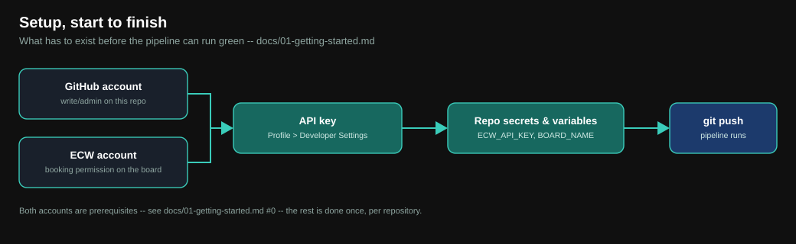

# Getting started

This is the step-by-step path from **nothing** to a green pipeline run that
flashes an Arduino UNO R4 WiFi on the ECW dev environment
(`https://dev.edgebench.io`) and runs hardware-in-the-loop CI jobs against
it. Follow it top to bottom the first time; every step says exactly where to
click and what you should see.



> **Which pipeline does this guide set up?** The default one, described in
> [docs/09-wait-mode.md](09-wait-mode.md): a single workflow whose `Wait` job
> polls until your booking starts. If you would rather have ECW wake a second
> workflow the moment the booking starts (no runner sitting idle), do this
> guide first, then follow [the two-stage guide](07-trigger-mode.md).
> Its workflow files are on `delelop_2_stages`; the guide explains how to
> copy them into your repository's default branch.

## The 10-minute checklist

If you just want the list, here it is. The rest of this page explains each
line.

- [ ] Create your own repository **from this template** (step 1)
- [ ] Have an ECW account on `https://dev.edgebench.io` (step 2)
- [ ] Create an ECW **API key** and copy it (step 3)
- [ ] Add repository **secret** `ECW_API_KEY` (step 4)
- [ ] Add repository **variable** `BOARD_NAME` = `Arduino UNO R4 WiFi` (step 5)
- [ ] Select the ECW environment with `ECW_BACKEND_URL`; use a token from
      that environment
- [ ] For HIL: set `HIL_SENSOR_NAME`, add its frontend-format CSV under
      `.github/user/hil/`, and confirm the backend exposes `/v1/peripheral-prepare`
- [ ] Confirm the bundled `build.sh` is executable and the three job files
      exist (steps 6 and 7)
- [ ] Start the workflow (step 8) and read the results (step 9)

## 0. Prerequisites

- **A GitHub account with admin (or maintain) access to the repository you
  will create.** Repository secrets and variables live under **Settings**,
  which needs that level of access.
- **An ECW account** on your ECW frontend, `https://dev.edgebench.io` for the
  dev environment, with permission to book the board type you want. If a
  later run fails at `Reserve` with a `403` or `404`, ask whoever administers
  your ECW deployment whether your account may book that board before
  debugging the template.
- **The board must already exist in ECW**: registered in the board-type
  catalog and physically connected to a resource-manager host ECW controls.
  This template only handles the GitHub side; onboarding hardware into ECW is
  an ECW-admin task outside this repository. For the Arduino example, the
  board type is named `Arduino UNO R4 WiFi`.
- **Nothing to install locally to run the pipeline.** Every job runs on
  GitHub's `ubuntu-latest`, and all helper scripts use only the Python
  standard library.
- **Python 3.10+ on your own machine, only if** you want to scaffold job files
  with `scripts/generate_job_payload.py` (step 7). Check with
  `python3 --version`.
- **Whatever your own build needs.** The bundled Arduino `build.sh` installs
  `arduino-cli` itself. For another project, your `build.sh` must install its
  own toolchain, because `ubuntu-latest` starts from a clean VM every run.

## 1. Start from a template

You do not fork this repository and you do not clone it and push it
somewhere. You create a **new repository from it**, which gives you a clean
copy with no history to untangle.

1. Open this repository on GitHub:
   `https://github.com/DevHeadsCommunity/ECW_CI_Github_Actions_Templates`.
2. Click the green **Use this template** button (top right, next to **Code**)
   and choose **Create a new repository**.
3. Pick the **Owner** (your user or your organisation) and a **Repository
   name**, for example `my-board-ci`.
4. Choose **Public** or **Private**. Both work. (Private repositories consume
   your plan's Actions minutes; public ones are free on GitHub-hosted
   runners.)
5. Leave **Include all branches** *unchecked* for the normal pipeline. You
   only need it if you plan to use trigger mode straight away, and even then
   [docs/07-trigger-mode.md](07-trigger-mode.md) shows a way that works
   without it.
6. Click **Create repository**. GitHub creates it within a few seconds with a
   single branch, `main`.

### Starting from your own existing repository instead

If you already have a firmware repository, copy these paths into it instead
of using the template button:

```
.github/workflows/ci-job-smoke.yml
.github/workflows/ci-client-tests.yml (optional; copy tests/ too)
.github/scripts/                     (copy as-is, do not edit)
.github/user/                        (then make it yours, see steps 6 and 7)
scripts/generate_job_payload.py      (optional authoring helper)
tests/                              (required with ci-client-tests.yml)
```

Everything project-specific lives in `.github/user/` and in your repository's
own GitHub settings. Nothing else needs to change.

Then clone your new repository so you can edit files locally:

```bash
git clone https://github.com/<owner>/<repo>.git
cd <repo>
```

> **Actions are on by default** in a repository created from a template. If
> you see a banner on the **Actions** tab saying workflows are disabled (this
> happens on forks), click **I understand my workflows, go ahead and enable
> them**.

## 2. Make sure you have an ECW account

Open `https://dev.edgebench.io`, sign in (or sign up), and confirm you can
see the board catalog. You need this account before you can create an API key.

## 3. Create an ECW API key

The workflow authenticates to the ECW backend with an API key sent as the
`X-API-Key` header, not with your email and password. Create it in the web
app:

1. Log in at `https://dev.edgebench.io` and open **Profile > Developer
   Settings**.
2. Under **API Keys Management**, click **Create New API Key**.
3. Enter a token name, for example `github-actions`, and click **Create
   Token**.
4. Click the new key's name in the list to open the copy dialog and **copy the
   value now**. It is shown in full only once. If you miss it, revoke that key
   on the same screen and create a new one.

Keep the value in your clipboard for the next step. Do not paste it into a
file in the repository.

## 4. Add the secret `ECW_API_KEY`

In **your** repository on GitHub:

1. Click **Settings** (the repository's settings, not your account's).
2. In the left sidebar, open **Secrets and variables > Actions**.
3. Stay on the **Secrets** tab and click **New repository secret**.
4. **Name:** `ECW_API_KEY` (exactly, uppercase).
5. **Secret:** paste the API key from step 3.
6. Click **Add secret**.

You will see `ECW_API_KEY` listed with the value hidden. GitHub never shows
it again and masks it in logs.

## 5. Add the variable `BOARD_NAME`

Still under **Settings > Secrets and variables > Actions**:

1. Switch to the **Variables** tab.
2. Click **New repository variable**.
3. **Name:** `BOARD_NAME` (exactly, uppercase).
4. **Value:** `Arduino UNO R4 WiFi`
5. Click **Add variable**.

`BOARD_NAME` is required and has no default on purpose: the pipeline does a
case-insensitive substring match against the backend's board types, and an
empty value would silently book the first board that matches nothing. If it
is missing, `Reserve` stops with a clear message.

Optional variables (leave them unset for your first run):

| Variable | Default | When to set it |
| --- | --- | --- |
| `ECW_BACKEND_URL` | `https://api-dev.edgebench.io` | Only to point at another ECW backend, for example staging. |
| `ECW_BOOKING_WAIT_TIMEOUT_SECONDS` | `86400` | Only to make `Wait` give up sooner than 24 hours. |
| `ECW_JOB_WAIT_TIMEOUT_SECONDS` | `180` | Only if one of your CI jobs runs longer than 3 minutes. |

Details for every secret and variable are in
[docs/02-secrets-and-variables.md](02-secrets-and-variables.md).

## 6. Check the build script

The pipeline's `Build` job runs exactly one thing:
`.github/user/build/build.sh`. For the Arduino example, it already works, so
your only job here is to confirm it is executable:

```bash
ls -l .github/user/build/build.sh      # should start with -rwxr-xr-x
```

If it is not executable (this can happen after copying files on some
systems), fix it and commit the mode change:

```bash
chmod +x .github/user/build/build.sh
git add .github/user/build/build.sh
git commit -m "make build.sh executable"
```

What the script must do (and how to adapt it to your own project) is in
[docs/03-build-script.md](03-build-script.md). The one rule to remember: it
must leave **exactly one `.bin` file** in `./build/`.

To use your own Arduino sketch instead of the demo, put it under `src/` and
change `FIRMWARE_SKETCH` (and `FQBN` / `ARDUINO_CORE` / the library list if
the board or libraries differ) at the top of `build.sh`.

## 7. Create your CI jobs

CI jobs describe **what to run against the board after it is flashed**. They
are plain JSON files in `.github/user/jobs/`, one file per job, run in
filename order. The template already ships three that work for the Arduino
demo, so **for your first run you do not need to create anything**:

| File | What it does |
| --- | --- |
| `01_wait.json` | Waits about a minute after flashing so the board settles. |
| `02_serial.json` | Captures serial output from the MCU and the MPU. |
| `03_camera.json` | Takes a camera screenshot of the board. |

When you are ready to add your own, you have two options.

**Option A: scaffold one interactively** (needs Python 3.10+ locally):

```bash
python3 scripts/generate_job_payload.py
```

It asks for a label, a request id, a name, a duration and one or more
commands, then writes `.github/user/jobs/NN_<label>.json` using the next free
`NN_` prefix. Run it with `--help` to see the non-interactive form.

**Option B: copy an existing file and edit it.** For example, to add a reset
job, copy `03_camera.json` to `04_reset.json`, then change `request_id`,
`name` and the `commands` list. The `NN_` prefix decides the order, and the
job label is whatever follows it.

Commit and push new job files like any other change. The full field reference,
the list of commands used by the examples, and a worked example are in
[docs/04-jobs.md](04-jobs.md).

## 8. Start the workflow

The workflow is `ECW CI Job Smoke` (`.github/workflows/ci-job-smoke.yml`). It
starts in either of two ways.

**Manually (best for the first run):**

1. Open your repository's **Actions** tab.
2. In the left list, click **ECW CI Job Smoke**.
3. Click **Run workflow**, keep the branch selected, and click the green
   **Run workflow** button.

**On a pull request:** the file ships with

```yaml
on:
  pull_request:
    branches:
      - develop
      - main
```

so opening a pull request into `develop` or `main`, pushing new commits to
that pull request, or reopening it starts the workflow. A plain push to a
branch does **not** start it. To try it: create a branch, change something
(for example the `val` character in the sketch), push the branch, and open a
pull request into `main`. The run appears on the pull request as a check.
Edit the `branches:` list to match your own base branches. That list is the
**only** line in the workflow a copy of this template is expected to edit.

Two things to know:

- Open the pull request from a branch **inside the same repository**. GitHub
  does not hand secrets to pull requests from forks, so `Reserve` would fail
  with "Missing ECW_API_KEY".
- Runs queue instead of overlapping. Every run books, flashes and releases the
  same board, so a second pull request (or a second push to the same one)
  waits for the first run to finish rather than racing it.

## 9. Watch it run and read the results

Open the run in the **Actions** tab. You will see eight jobs:

```
Build -> Reserve -> Wait -> Configure HIL -> Upload -> Test -> Collect -> Release
```

| Job | What you should see |
| --- | --- |
| `Build` | `arduino-cli` installs, the sketch compiles, one `.bin` is uploaded as an artifact. |
| `Reserve` | It finds your board type, then reuses your closest existing booking or creates one. The log prints the booking id. |
| `Wait` | Polls until the booking is active. Immediate if the board is free; otherwise it waits for your slot, up to 24 hours. |
| `Configure HIL` | Uses `HIL_SENSOR_NAME` and frontend-format CSVs under `.github/user/hil/`; skips setup if the variable is blank. |
| `Upload` | Stores the `.bin`, verifies its stored filename, then explicitly flashes it to the board. |
| `Test` | Creates your CI jobs and polls them until each one finishes. |
| `Collect` | Uploads everything the jobs captured as an artifact. |
| `Release` | Cancels the booking so the board is free for the next person. It runs even when an earlier job failed. |

A successful Arduino run leaves a workflow artifact named
`ecw-ci-job-smoke-<run-id>` (at the bottom of the run summary page).
Download it and check that:

- `gha-mcu.log` contains lines like `Your value is D`.
- `gha-frame.jpg` shows the onboard LED lit and a static `D` on the LED
  matrix.
- `gha-mpu.log` is empty. That is **expected** on this single-MCU board.

To prove the whole loop is really yours, change `val` in
`src/arduino_ci_demo/arduino_ci_demo.ino` from `'D'` to another character,
commit, run the workflow again and confirm the new character in the serial log
and photo.

## Troubleshooting

| Symptom | Likely cause and fix |
| --- | --- |
| `Build` fails: "Missing or non-executable build.sh" | Step 6: the file is missing or not executable. |
| `Build` fails compiling | Wrong `FQBN` / core / library for your board, or a sketch error. Run `build.sh` locally to see the compiler output. |
| `Reserve` fails: "Missing BOARD_NAME" | Step 5: the variable is missing, misspelled, or was added as a *secret* instead of a *variable*. |
| `Reserve` fails: "Missing ECW_API_KEY" | Step 4: the secret is missing or misspelled. |
| `Reserve` fails with `401` | The API key is wrong, revoked or copied with extra whitespace. Create a new one (step 3) and update the secret. |
| `Reserve` fails with `403` / `404` | Your ECW account may not be allowed to book that board, or `BOARD_NAME` matches no board type. Check the exact board name in the ECW catalog. |
| `Reserve` cannot reach the backend | `ECW_BACKEND_URL` is wrong, or the backend is down. Check the chosen environment and its API base path. |
| `Wait` runs for a long time | The board is booked by someone else, so your slot starts later. Waiting is normal; cancel the run if you do not want to wait. |
| `Upload` fails: "exactly one .bin file" or "file is empty" | `build.sh` must leave exactly one non-empty `.bin` in `./build/`. |
| `Configure HIL` is skipped | Set `HIL_SENSOR_NAME` to enable it; blank intentionally skips setup. |
| `Configure HIL` fails with 404 on `/v1/peripheral-prepare` | The chosen backend does not expose the frontend preparation API. Check `ECW_BACKEND_URL` and the deployed backend version. |
| `Configure HIL` fails on CSV validation or times out | Check the sensor name, frontend CSV columns/ranges, and HIL preparation on the booked board. The timeout is three minutes. |
| `Upload` fails during explicit flashing | Storage upload alone does not program the MCU. Check the separate flash response and backend/RM logs. |
| `Test` fails on one job | Open the `Test` log and the `ecw-ci-job-smoke-<run-id>` artifact: each job's logs and result are saved there. |
| Nothing starts | Pushing a branch does not start it; open a pull request into a branch listed under `on.pull_request.branches` (step 8), or use **Run workflow**. |

For every backend call the pipeline makes, see
[docs/05-api-reference.md](05-api-reference.md). For what is supported and
what is on you, read [docs/06-support-and-liability.md](06-support-and-liability.md).

## Where to go next

- How the eight jobs fit together, timeouts, and failure behaviour:
  [docs/09-wait-mode.md](09-wait-mode.md).
- The Arduino demo explained line by line:
  [docs/08-arduino-demo.md](08-arduino-demo.md).
- Stop paying for a runner that sits waiting:
  [docs/07-trigger-mode.md](07-trigger-mode.md), with workflow files from
  `delelop_2_stages`.

## Optional HIL sensor values

Set the GitHub repository variable `HIL_SENSOR_NAME` to the ECW sensor name,
then edit its physical-value CSV under `.github/user/hil/` or copy a frontend
CSV export there. `HIL_CSV_FILE` optionally selects another filename in that
folder. See [Configure HIL](10-hil-configuration.md) for the three-minute
readiness deadline, supported formats and existing frontend API calls.
