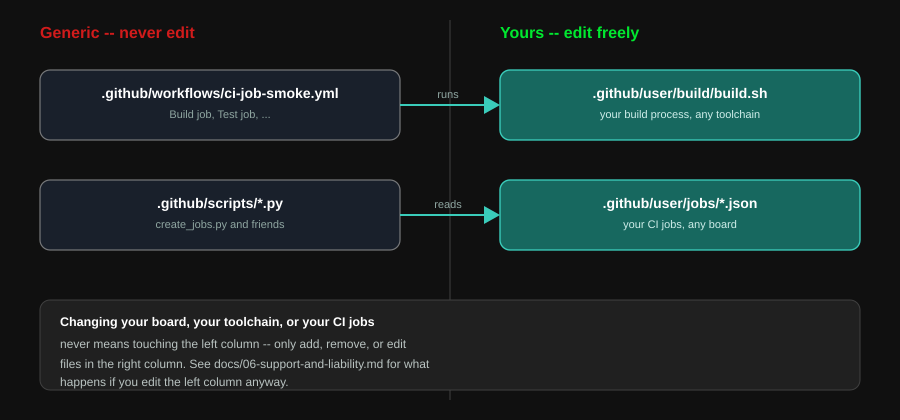

# Writing `.github/user/build/build.sh`



This is the one place your project's build knowledge lives. The workflow's
`Build` job does exactly this and nothing else:

```yaml
- name: Run project build script
  run: |
    if [ ! -x .github/user/build/build.sh ]; then
      echo "Missing or non-executable .github/user/build/build.sh -- see .github/user/README.md."
      exit 1
    fi
    .github/user/build/build.sh
```

## The contract

- **Executable.** `chmod +x .github/user/build/build.sh` (git tracks the
  execute bit -- commit it that way, don't rely on setting it at CI time).
- **Runs from the repository root**, after checkout. Don't assume any
  other working directory.
- **Must leave exactly one `*.bin` file inside `./build/`** when it exits
  successfully. The `Build` job uploads the whole `build/` directory as an
  artifact; the `Upload` job later finds that one file *by extension*, not
  by name -- so call your output file whatever you want, but leave exactly
  one. Zero or more than one fails the `Upload` job with a clear error
  message rather than silently flashing the wrong thing.
- **Exit non-zero on failure.** `set -euo pipefail` at the top of the
  script (as the example does) is the easiest way to get this for free --
  any failed command aborts the script and fails the `Build` job.

Nothing else is required. Install your own toolchain, run your own
compiler, generate your own binary -- however your project needs to.

### Runner environment

The `Build` job runs on `runs-on: ubuntu-latest` -- a clean, ephemeral
Ubuntu VM (currently Ubuntu 24.04 on GitHub's hosted runners) with no
project-specific tooling pre-installed and no state carried over between
runs. That has two consequences for `build.sh`:

- It must install its own toolchain from scratch every run (as the
  Arduino example below does with `arduino-cli`) -- don't assume anything
  beyond what `ubuntu-latest` ships by default (git, curl, a recent Python
  3, bash, standard build-essential-adjacent tools).
- Nothing it installs persists to the next run, so don't rely on caching
  behavior unless you add `actions/cache` yourself around the relevant
  step -- out of scope for this generic workflow, but nothing stops you
  from adding it inside `build.sh` or as an extra step per
  [docs/06-support-and-liability.md](06-support-and-liability.md).

If your build needs a self-hosted runner instead (e.g. licensed
toolchains, specific hardware access at build time -- not to be confused
with the board itself, which is remote via ECW, not local to the runner),
that's a change to `runs-on:` in `ci-job-smoke.yml` itself, which falls
under "unsupported, at your own risk" -- see
[docs/06-support-and-liability.md](06-support-and-liability.md).

## Worked example: the Arduino UNO R4 WiFi reference

This repo's own `.github/user/build/build.sh` (and `src/arduino_ci_demo/`)
is a real, working example -- not just a snippet. Read alongside it:

```bash
#!/usr/bin/env bash
set -euo pipefail

FQBN="arduino:renesas_uno:unor4wifi"
ARDUINO_CORE="arduino:renesas_uno"
FIRMWARE_SKETCH="src/arduino_ci_demo"
```
Project-specific constants live at the top of the script, not as workflow
env vars -- nothing outside this file needs to know what board or toolchain
you're using.

```bash
if ! command -v arduino-cli >/dev/null 2>&1; then
  mkdir -p "$HOME/bin"
  curl -fsSL https://raw.githubusercontent.com/arduino/arduino-cli/master/install.sh | BINDIR="$HOME/bin" sh
  export PATH="$HOME/bin:$PATH"
fi
```
Installs the toolchain if the runner doesn't already have it. The install
script always grabs the latest `arduino-cli` release (1.5.x as of this
writing); pin a version by downloading a specific release archive instead
if your build needs reproducibility across runs.
`export PATH=...` (not `echo ... >> "$GITHUB_PATH"`) matters here: `
$GITHUB_PATH` only takes effect starting the *next* workflow step, but
everything in this script runs within one single step -- so later commands
in the same script need the tool on `PATH` immediately, via a normal
shell export.

```bash
arduino-cli core update-index
arduino-cli core install "${ARDUINO_CORE}"

arduino-cli lib update-index
arduino-cli lib install "ArduinoGraphics"
```
Installs whatever platform support and libraries your build needs. A
GitHub-hosted runner starts fresh every run, so this always runs; a
self-hosted runner with a persistent toolchain would skip straight past
these thanks to `arduino-cli`'s own "already installed" checks.

```bash
mkdir -p build
arduino-cli compile --fqbn "${FQBN}" "${FIRMWARE_SKETCH}" --output-dir build
```
The actual build. `arduino-cli compile --output-dir build` produces
`build/<sketch-name>.ino.bin` among other files (`.elf`, `.hex`, `.map`) --
satisfying the "exactly one `*.bin`" contract without any extra cleanup
step, since only one of those has a `.bin` extension.

## Other toolchains

The contract doesn't care how you get to a `.bin` file. A few shapes this
commonly takes:

- **PlatformIO**: `pio run` writes to `.pio/build/<env>/firmware.bin`;
  `cp` or symlink it into `./build/`.
- **Make/CMake + a cross-compiler + `objcopy`**: build your `.elf`, then
  `arm-none-eabi-objcopy -O binary firmware.elf build/firmware.bin` (or
  equivalent for your toolchain).
- **Pre-built artifact checked into the repo**: `build.sh` can be as
  simple as `mkdir -p build && cp src/prebuilt.bin build/`.

## Debugging a build locally

Run the script exactly as CI does, from the repo root:

```bash
./.github/user/build/build.sh && ls build/
```

If it fails locally, it will fail in CI identically -- there's no
CI-specific magic in the `Build` job to work around.
