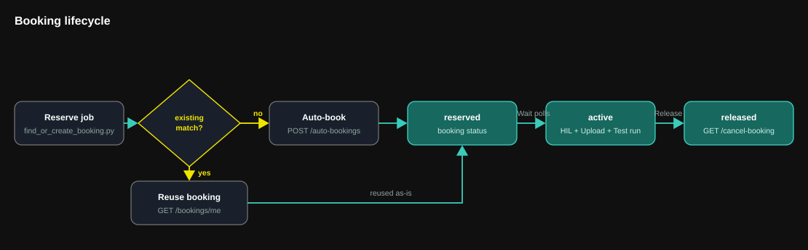

# ECW API reference

The endpoints this pipeline's scripts actually call, in the order they're
called. Every authenticated call (all but login) sends the API key from
[docs/02-secrets-and-variables.md](02-secrets-and-variables.md) as an
`X-API-Key` header.

## Authentication (one-time setup, not part of the workflow)

### `POST /auth/jwt/login`

Body: `{"email": "...", "password": "..."}`. Returns `{"token": "...",
"expiry": 3600}` -- a short-lived session JWT, used only to mint an API
key next. Rate-limited (5 requests/minute per IP).

### `POST /generate-api-key?name=<label>`

Auth: `Authorization: Bearer <jwt from login>`. Returns `{"api_key":
"..."}` -- store this as your `ECW_API_KEY` repo secret. This is the only
time the key is returned in full.

### `GET /get-user-api-keys`

Lists your active (non-revoked) key names -- doesn't return the key
values themselves.

### `GET /revoke-api-key?name=<label>`

Revokes a key by name. Do this if a key ever leaks.

## Board discovery -- `select_board.py`

### `GET /board_types?page_no=1&page_size=100`

Returns the backend's known board types. The script matches `BOARD_NAME`
(case-insensitive substring) against each entry's `board_name` and picks
the first match.

## Booking -- `find_or_create_booking.py`

### `GET /bookings/me?page_no=1&page_size=100`

Returns your own non-cancelled bookings whose `end_utc` hasn't passed,
ordered by `start_utc` ascending. The script reuses the first entry
matching the selected board name instead of always creating a new booking,
so repeated pipeline runs don't pile up reservations.

### `POST /auto-bookings?board_name=<name>`

Creates a new reservation for the first available slot of that board type
(searches up to 24h ahead), if no reusable booking was found above.

## Waiting for activation -- `wait_for_booking.py`

### `GET /booking?booking_id=<id>`

Polled until the booking's `status` is `active` and the
current time falls within `[start_utc, end_utc)`.

## Firmware upload and flash -- the `Upload` step

`upload_and_flash.py` performs two explicit operations in order:

1. `POST /upload?booking_id=<id>` with multipart field `file` stores the
   single non-empty `.bin` from `build/`. It does not program or reset the board.
2. After verifying the stored filename through
   `GET /v1/artifacts/my-uploads?booking_id=<id>`, call
   `POST /v1/artifacts/my-uploads?booking_id=<id>&code=<stored-filename>` to
   explicitly flash that MCU image through the backend/RM.

Both responses must report `status=okay`; upload success alone is not flash
success. The uploaded basename uses ASCII letters, digits, dots and underscores,
with a stem of at most 60 characters plus `.bin`. The verified name is passed
to the flash helper. No automatic flash retry is performed. A failed flash
preserves the stored file but prevents Test from starting.

The booking must be active within its session window. Configure HIL runs
before either operation; see [the HIL API and CSV guide](10-hil-configuration.md).

## CI jobs -- `create_jobs.py` / `poll_jobs.py` / `download_artifacts.py`

### `POST /v1/ci/jobs`

Body: `{"booking_id": <id>, ...one job spec from .github/user/jobs/*.json}`.
Creates and queues one CI job. Returns the created job, including its `id`.

### `GET /v1/ci/jobs/{id}`

Polled until `status` is one of `succeeded`, `failed`, `cancelled`,
`invalid` (note: successful jobs report `succeeded`, never `passed`).

### `GET /v1/ci/jobs/{id}/logs`

Structured log lines for one job -- what actually happened at each
command.

### `GET /v1/ci/jobs/{id}/results`

Structured results (e.g. captured filenames/sizes) for one job.

### `GET /v1/ci/jobs/{id}/artifacts.zip`

A zip bundle of whatever files the job's commands produced (serial logs,
camera screenshots, ...). Downloaded best-effort -- a 404 here (no
artifacts collected) is treated as a warning, not a pipeline failure.

## Cleanup -- the `Release` job

### `GET /cancel-booking?booking_id=<id>`

Releases the booking, freeing the board for the next reservation. Runs
even if earlier jobs failed, as long as `Reserve` itself succeeded (see
the `Release` job's `if:` condition in the workflow).
