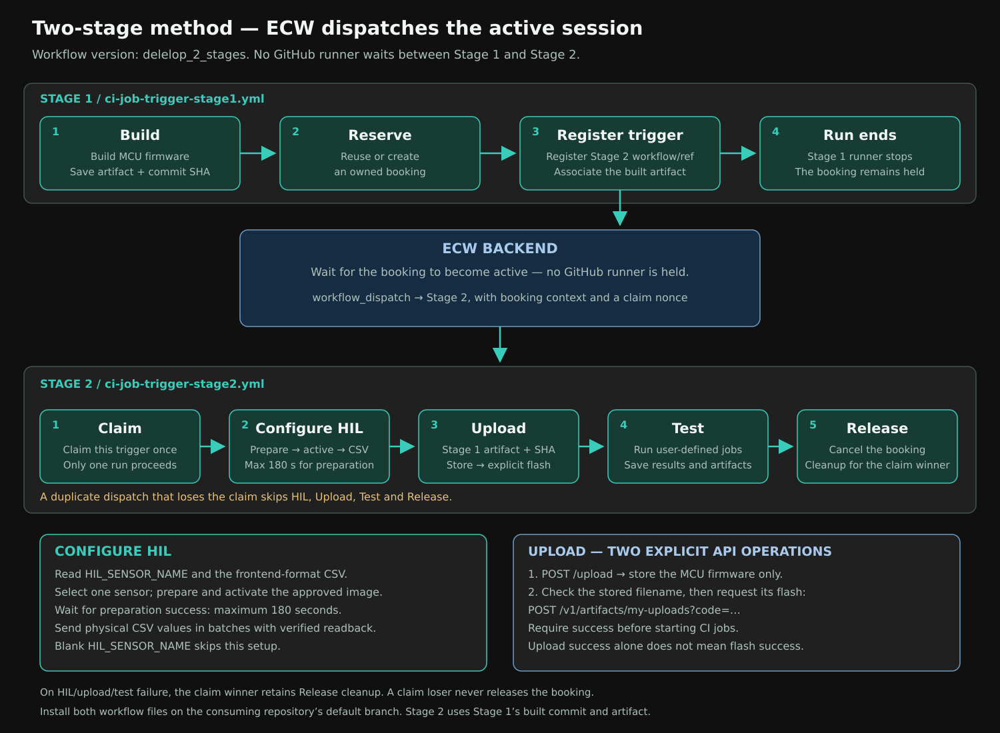

# Two-stage mode (`delelop_2_stages`)

`ci-job-smoke.yml` (see [docs/09-wait-mode.md](09-wait-mode.md)) is simple,
but its `Wait` job holds a runner, up to 24 hours, polling `GET /booking`
until your reservation becomes active. That is fine occasionally. If you
auto-book far in advance or run this a lot, it adds up in runner-minutes and,
on a self-hosted runner, ties one machine up for the whole wait.

Trigger mode replaces that one long-lived pipeline with two short ones and
lets ECW start the second itself:



Compare with the [single-workflow method diagram](diagrams/one-stage-method.svg).

Stage 1 builds your firmware, reserves the board, tells ECW "call this
workflow back when the booking activates" (`PUT
/v1/ci/bookings/{id}/activation-trigger`), and **stops**. No runner is left
waiting. Stage 2 does not exist as a running job until ECW dispatches it.

> **Do not run both pipelines against the same booking.** `ci-job-smoke.yml`
> and the two trigger workflows are two ways to drive the same booking
> lifecycle. Two runs would both try to upload, test and release the same
> booking and race each other. Pick one per booking.

## Start from a template

Trigger mode is an add-on to the normal setup, so the starting point is the
same as for wait mode.

1. **Create your repository from the template** and finish
   [docs/01-getting-started.md](01-getting-started.md) at least through step
   5, so you have the `ECW_API_KEY` secret and the `BOARD_NAME` variable. A
   working first run of wait mode is the best proof your ECW account, board
   and build are fine before you add trigger mode on top.
2. **Copy the trigger files into your repository's default branch** (usually
   `main`). You need exactly these three:

   ```
   .github/workflows/ci-job-trigger-stage1.yml
   .github/workflows/ci-job-trigger-stage2.yml
   .github/scripts/register_activation_trigger.py
   ```

   This works whether or not you ticked **Include all branches** when you
   created the repository, and from any starting point (a template copy, a
   fork, or your own firmware repository). From a clone of **your**
   repository, on its default branch:

   ```bash
   git remote add template https://github.com/DevHeadsCommunity/ECW_CI_Github_Actions_Templates.git
   git fetch template delelop_2_stages
   git checkout template/delelop_2_stages -- \
     .github/workflows/ci-job-trigger-stage1.yml \
     .github/workflows/ci-job-trigger-stage2.yml \
     .github/scripts/register_activation_trigger.py
   git commit -m "add ECW trigger-mode workflows"
   git push origin HEAD
   ```

   If your repository does not have the other helper scripts yet
   (`ecw_client.py`, `select_board.py`, `find_or_create_booking.py`,
   `create_jobs.py`, `poll_jobs.py`, `download_artifacts.py`), copy the whole
   `.github/scripts/` folder, including `hil_profiles/`, from
   `template/delelop_2_stages` the same way. Copy `.github/user/hil/` for
   frontend-format example CSVs and the HIL format guide.

> **The Stage 2 file must be on the default branch.** GitHub's
> `workflow_dispatch` API only accepts workflow files that exist there. If
> you push the files to a feature branch only, ECW's dispatch will fail (you
> will see the trigger end in `failed`, see the troubleshooting table).

## One extra secret: `ECW_DISPATCH_PAT`

Registering a trigger asks ECW to call GitHub's `workflow_dispatch` REST API
on your behalf. That needs its own credential: `ECW_API_KEY` authenticates
you *to ECW*, not to GitHub.

1. On GitHub, click your profile picture and open **Settings** (your
   **account** settings, not the repository's).
2. Scroll to **Developer settings > Personal access tokens > Fine-grained
   tokens** and click **Generate new token**.
3. **Token name:** something like `ecw-dispatch`.
4. **Expiration:** longer than the longest time you might wait for a booking
   to start (at least a few days for a first test). An expired token makes
   the dispatch fail.
5. **Resource owner:** whoever owns your repository.
6. **Repository access:** *Only select repositories*, then pick just this
   repository.
7. **Permissions > Repository permissions:** set **Actions** to **Read and
   write**. Nothing else is required.
8. Click **Generate token** and **copy it now**. GitHub shows it once.
9. In your repository, open **Settings > Secrets and variables > Actions >
   Secrets > New repository secret**, name it `ECW_DISPATCH_PAT`, paste the
   token and click **Add secret**.

The token lets ECW start a workflow run in your repository. It cannot read
your code or push commits. ECW stores it encrypted, uses it once, and wipes it
as soon as the dispatch succeeds or the trigger ends. If it ever leaks,
regenerate it and update the secret.

## How to test the trigger, step by step

This is the full procedure for proving the whole loop works with the Arduino
UNO R4 WiFi on `dev.edgebench.io`. Budget about 15 minutes if the board is
free. Each step says what you should see, so you know when something is off.

### Step 1. Preflight from your terminal

Set your key in the shell (use a leading space or turn off history so it does
not end up in your shell history):

```bash
export ECW_API_KEY='paste-your-key-here'
export ECW_BACKEND_URL='https://api-dev.edgebench.io'
```

Check that the backend you are pointing at has trigger support:

```bash
curl -s -A ecw-ci-smoke-script "$ECW_BACKEND_URL/openapi.json" | grep -o 'activation-trigger[^"]*' | sort -u
```

You should see two lines: `activation-trigger` and
`activation-trigger/claim-run`. If nothing prints, that backend does not have
the feature yet: ask your ECW admin (see "For ECW administrators" below).

Check that your key works and see your current bookings:

```bash
curl -s -A ecw-ci-smoke-script -H "X-API-Key: $ECW_API_KEY" \
  "$ECW_BACKEND_URL/bookings/me?page_no=1&page_size=20"
```

A JSON list means the key is valid. A `401` means the key is wrong: create a
new one ([getting started, step 3](01-getting-started.md#3-create-an-ecw-api-key)).

### Step 2. Start from a clean booking

Stage 1 reuses your closest existing booking for the board. That is what you
want for a normal run, but for a test it can bite you: if that booking is
already `active` and its trigger has **already fired**, ECW refuses to
register another one (`409`), because that would dispatch a second run for the
same activation.

So before the test, look at the list from step 1. If you already hold a
booking for `Arduino UNO R4 WiFi`, cancel it and let Stage 1 create a fresh
one:

```bash
curl -s -A ecw-ci-smoke-script -H "X-API-Key: $ECW_API_KEY" \
  "$ECW_BACKEND_URL/cancel-booking?booking_id=<BOOKING_ID>"
```

(You can also cancel it from the ECW frontend.)

### Step 3. Run Stage 1

1. In your repository, open the **Actions** tab.
2. In the left list, click **ECW CI Trigger - Stage 1 (Build & Reserve)**.
3. Click **Run workflow**, leave `active_ref` empty and the branch on your
   default branch, then click the green **Run workflow** button.

Stage 1 has two jobs, `Build` and `Reserve & register trigger`, and it
finishes green in a few minutes. In the `Reserve & register trigger` job you
should see one line in the `Find or create booking` step and one in the
`Register session-activation trigger` step:

```
Reusing existing booking 123 for Arduino UNO R4 WiFi        (or: Created booking: 123)
Registered activation trigger 45 for booking 123 -> your-org/your-repo (ci-job-trigger-stage2.yml@main), status=pending
```

Write down the **booking id** (`123` above). It is also in the
`ecw-ci-trigger-reserve-<run-id>` artifact (`booking.json`,
`activation-trigger.json`).

If `status=pending`, the trigger is armed and Stage 1 is done. If Stage 1 is
red, jump to "Troubleshooting" below.

### Step 4. Watch the trigger in ECW

You can watch ECW's view of the trigger with one call (replace `123`):

```bash
curl -s -A ecw-ci-smoke-script -H "X-API-Key: $ECW_API_KEY" \
  "$ECW_BACKEND_URL/v1/ci/bookings/123/activation-trigger"
```

The `status` field moves through:

| `status` | Meaning |
| --- | --- |
| `pending` | Armed. Waiting for the booking to become active. |
| `dispatching` | ECW is calling GitHub right now. |
| `fired` | GitHub accepted the dispatch (HTTP 204). `fired_at` is set. |
| `failed` | ECW could not dispatch. Read `last_status_code` and `last_error`. |
| `cancelled` | The trigger was cancelled, or the booking was cancelled. |

The credential is never returned, and it is wiped from ECW's database once
the trigger is `fired` or `failed`.

### Step 5. Wait for ECW to fire Stage 2

- **If the board is free**, your booking starts right away and ECW activates
  it within moments. The trigger goes `pending` to `dispatching` to `fired`
  quickly.
- **If the board is busy**, your booking starts later. Nothing runs and
  nothing is billed in the meantime, which is the whole point. Check
  `start_utc` in `booking.json` to see when.

In the **Actions** tab a new run appears by itself: **ECW CI Trigger - Stage
2 (Active Session)**, started by `workflow_dispatch` (you did not click
anything). It has five jobs:

| Job | What you should see |
| --- | --- |
| `Claim run` | `Claimed -- this is the run that does the real work.` |
| `Configure HIL` | Prepares the selected HIL sensor, waits for activation, then sends frontend-format CSV values; skips setup if the sensor variable is blank. |
| `Upload` | After Configure HIL succeeds, announces the booking id, board name and session window, downloads Stage 1's firmware artifact, and flashes the board. |
| `Test` | Creates and runs your `.github/user/jobs/*.json` jobs and uploads artifact `ecw-ci-job-active-<run-id>`. |
| `Release` | Cancels the booking. |

### Step 6. Confirm it worked

Tick each of these:

- [ ] Stage 1 is green and printed `status=pending`.
- [ ] Stage 2 appeared without you starting it.
- [ ] `Claim run` printed `Claimed`, and `Configure HIL`, `Upload`, `Test`, `Release` ran.
- [ ] The trigger call from step 4 now shows `"status": "fired"`, `attempts`
      of `1`, `fired_at` filled in and `run_claimed_at` filled in.
- [ ] For the Arduino demo: `gha-mcu.log` in `ecw-ci-job-active-<run-id>`
      contains `Your value is D`, and `gha-frame.jpg` shows the lit LED and
      a static `D`. (`gha-mpu.log` is empty on this board, which is
      expected.)

If all five pass, trigger mode works end to end.

### Step 7 (optional). Negative tests

These take a couple of minutes each and prove the safety nets work. Do them
on a fresh booking each time (step 2).

**A. A late duplicate is ignored.** Open the finished Stage 2 run and click
**Re-run all jobs**. It replays the original inputs, including the same
`activation_nonce`. `Claim run` should now log `Already claimed by another
run (expected for a duplicate dispatch).` and `Configure HIL`, `Upload`, `Test` and `Release`
should be **skipped**. That is exactly what protects a live session from a
duplicate dispatch: it does not flash, test or release anything a second time.

**B. A bad token is reported, not swallowed.** Temporarily set
`ECW_DISPATCH_PAT` to a wrong value, run Stage 1 and wait for the booking to
activate. Stage 2 never starts, and the trigger call shows `"status":
"failed"` with `last_status_code` `401` (or `404`) and the GitHub message in
`last_error`. Restore the real token and run Stage 1 again: registering again
is allowed from `failed`.

**C. Cancelling before it fires.** While the trigger is still `pending`:

```bash
curl -s -X DELETE -A ecw-ci-smoke-script -H "X-API-Key: $ECW_API_KEY" \
  "$ECW_BACKEND_URL/v1/ci/bookings/123/activation-trigger"
```

The response shows `"status": "cancelled"` and Stage 2 never starts. (Once a
dispatch is in progress or done, this returns `409`.)

### Step 8. Clean up

- Cancel any leftover booking (`/cancel-booking?booking_id=...`), so the
  board is free for others.
- If this was only a test, revoke the `ECW_DISPATCH_PAT` on GitHub, or let it
  expire.

## Why there is a "Claim" job

GitHub's `workflow_dispatch` REST API has no delivery idempotency key. If
ECW's call to it fails to get acknowledged (a timeout, a crash right after
dispatching), the only safe thing ECW can do is dispatch again rather than
silently drop your session. That means Stage 2 must tolerate running **more
than once** for the same activation.

Every dispatch for the same activation carries the same `activation_nonce`.
The `Claim` job calls back into ECW (`POST
/v1/ci/bookings/{id}/activation-trigger/claim-run`) with that nonce before
doing anything else:

- **204**: this run claimed it first. `Configure HIL`, `Upload`, `Test` and `Release` proceed.
- **409**: some other run already claimed it (or the booking is no longer
  active). Every later job's `if: needs.claim.outputs.claimed == 'true'`
  skips, so this run ends cleanly and does not double-flash the board,
  double-run jobs, or race to release the booking.

Do not remove or bypass the `Claim` job or its `if:` conditions. See
[docs/06-support-and-liability.md](06-support-and-liability.md).

## What ECW injects into Stage 2

ECW passes these as `workflow_dispatch` inputs, and Stage 1 adds the last
three through `inputs_extra`. GitHub allows at most **10 inputs** per
workflow, and this uses all 10, so do not add more inputs to Stage 2.

| Input | Set by | Meaning |
| --- | --- | --- |
| `booking_id`, `board_id`, `board_type_id`, `board_name` | ECW | Which booking and board. |
| `starts_at`, `ends_at` | ECW | Session window, ISO-8601 UTC. |
| `activation_nonce` | ECW | One-time claim token (see above). |
| `run_id` | Stage 1 | Stage 1 run that built the firmware. |
| `sha` | Stage 1 | Commit the firmware was built from. |
| `backend_url` | Stage 1 | ECW backend base URL for Stage 2's calls. |

## Troubleshooting

| Symptom | Likely cause and fix |
| --- | --- |
| Stage 1 fails: "Missing ECW_DISPATCH_PAT" | Add the secret (see "One extra secret"). |
| Stage 1 register step fails with a bare `HTTP Error 409` | The booking is not in a registerable state, or its trigger already `fired` while the booking is still active. Cancel the booking and run Stage 1 again (step 2). |
| Register fails with `HTTP Error 422` | ECW rejected the request body: for example an `api_base_url` outside its allowed hosts, or `inputs_extra` over the input limit. Do not add extra inputs. |
| Register fails with `HTTP Error 503` | ECW has no stable encryption key configured for stored credentials. This is an ECW admin fix (see below). |
| Register fails with `HTTP Error 404` | The booking id is not yours, or the backend does not have the feature. Redo the preflight (step 1). |
| Stage 1 is green, trigger stays `pending` forever | The booking has not started yet (board busy). Check `start_utc`. |
| Trigger is `failed`, `last_status_code` 404 | The Stage 2 workflow file is not on the default branch, or `ECW_ACTIVE_WORKFLOW` / `active_ref` points at a file or ref that does not exist. |
| Trigger is `failed`, `last_status_code` 401 or 403 | The token is wrong, expired, or lacks **Actions: Read and write** on this repository. Fix the token, then run Stage 1 again. |
| Trigger is `failed`, `last_error` mentions the host | The API host is not in ECW's allowlist. GitHub.com works by default. |
| Trigger stays `dispatching` | GitHub did not answer in time. ECW retries and keeps the trigger claimable, because GitHub may already have started the run. Give it a few minutes and check the Actions tab. |
| Stage 2 starts but `Claim run` fails with an unexpected HTTP code | The `backend_url` input is wrong or unreachable from the runner. |
| `Claim run` says "Already claimed" on your first run | Another Stage 2 run claimed it first, or the booking was cancelled before Stage 2 started. Check the trigger's `run_claimed_at` and the booking. |
| `Upload` fails: cannot download artifact | Stage 1's artifact expired, or `run_id` is wrong. Run Stage 1 again. |
| No Stage 2 ever appears and you never saw `Registered activation trigger` | You ran wait mode (`ECW CI Job Smoke`) instead. Run **ECW CI Trigger - Stage 1**. |

## For ECW administrators

The backend needs, before anyone can register a trigger:

- The database migrations applied (the `ci_booking_activation_trigger` table
  and its follow-ups).
- A **stable** encryption key for stored dispatch credentials:
  `CI_ACTIVATION_TRIGGER_SECRET`, or a configured `API_TOKEN_SECRET`. A key
  generated per process is refused, because queued triggers must survive a
  restart.
- Optionally `CI_ACTIVATION_TRIGGER_ALLOWED_API_HOSTS` (defaults to
  `api.github.com`; add your GitHub Enterprise host if you use one).

The full list of `CI_ACTIVATION_TRIGGER_*` settings is in the backend's
`.env.example`.

## Everything else is unchanged

`BOARD_NAME`, `ECW_API_KEY`, `ECW_BACKEND_URL`,
`.github/user/build/build.sh` and `.github/user/jobs/*.json` all mean exactly
what they mean for `ci-job-smoke.yml`. See
[docs/02-secrets-and-variables.md](02-secrets-and-variables.md),
[docs/03-build-script.md](03-build-script.md) and
[docs/04-jobs.md](04-jobs.md). The only extra configuration for trigger mode
is the `ECW_DISPATCH_PAT` secret above.

## HIL configuration before Upload

After the claim succeeds, Stage 2 runs Configure HIL using `HIL_SENSOR_NAME`
and the frontend-format CSV under `.github/user/hil/` at the built commit.
It waits up to three minutes for preparation/activation success before sending values.
Upload then stores the MCU image and explicitly flashes it through two API
calls in the same step. A failed HIL step skips Upload and Test; the claim
winner still releases the booking. Duplicate runs that lose the claim skip
all hardware work and release. See [the HIL guide](10-hil-configuration.md).
