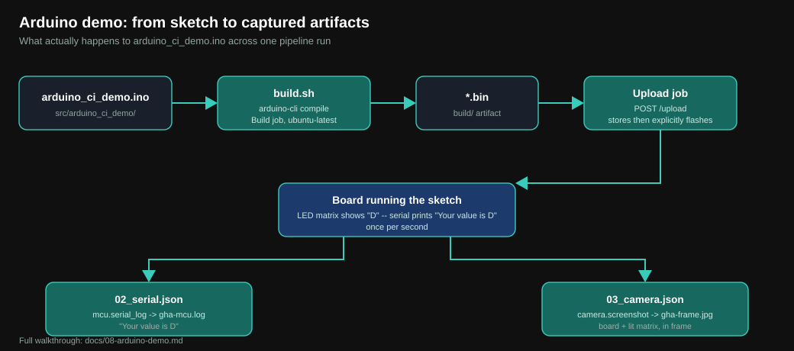

# The Arduino UNO R4 WiFi demo, in full



This template ships with a complete, working example targeting an
**Arduino UNO R4 WiFi** so you have something real to run before you touch
any of your own project's code. This doc walks through every piece of it.

## What it does, end to end

1. `.github/user/build/build.sh` compiles [src/arduino_ci_demo/arduino_ci_demo.ino](../src/arduino_ci_demo/arduino_ci_demo.ino)
   with `arduino-cli` into one `.bin`.
2. `ci-job-smoke.yml` books an `Arduino UNO R4 WiFi` board (`BOARD_NAME`),
   waits for the booking to go active, configures HIL when requested, then
   uploads and explicitly flashes that `.bin` within the Upload step.
3. Once flashed, the sketch prints `Your value is D` over serial once a
   second and lights the onboard LED matrix with a static `D`.
4. The `Test` job runs the three example CI jobs in
   [.github/user/jobs/](../.github/user/jobs/) against the now-flashed
   board and downloads whatever they capture.

## The sketch

[src/arduino_ci_demo/arduino_ci_demo.ino](../src/arduino_ci_demo/arduino_ci_demo.ino):

```cpp
#include "ArduinoGraphics.h"
#include "Arduino_LED_Matrix.h"

const char val = 'D';

ArduinoLEDMatrix matrix;

void setup() {
  Serial.begin(115200);
  pinMode(LED_BUILTIN, OUTPUT);
  digitalWrite(LED_BUILTIN, HIGH);
  matrix.begin();

  char text[2] = {val, '\0'};

  matrix.beginDraw();
  matrix.stroke(0xFFFFFFFF);
  matrix.textFont(Font_5x7);
  matrix.beginText(3, 0, 0xFFFFFF);
  matrix.println(text);
  matrix.endText();
  matrix.endDraw();
}

void loop() {
  Serial.print("Your value is ");
  Serial.println(val);
  delay(1000);
}
```

- `#include` order matters: `ArduinoGraphics.h` must come before
  `Arduino_LED_Matrix.h`, or the sketch fails to compile. `ArduinoGraphics`
  provides the font/draw calls the LED matrix library builds on.
- `matrix.endText()` is called with no scroll direction, so the character
  is drawn once and stays static -- no scrolling animation to synchronize
  against when a CI job later photographs it.
- `LED_BUILTIN` is driven high in `setup()` purely so the camera job's
  screenshot has an unambiguous "board is powered and running" signal, on
  top of the matrix glyph.
- `val` is the one line meant to be edited. Change the character, push, and
  watch the pipeline flash it and the serial/camera jobs capture the new
  value -- a fast way to see your own change go through the whole pipeline
  once before writing anything else.

## The build script

[.github/user/build/build.sh](../.github/user/build/build.sh) --
see [docs/03-build-script.md](03-build-script.md) for the line-by-line
walkthrough of *why* it's shaped this way (the `.bin`-in-`./build/`
contract, the `PATH` export, etc.). In short, for this demo:

- FQBN: `arduino:renesas_uno:unor4wifi`
- Core: `arduino:renesas_uno`
- Extra library: `ArduinoGraphics` (installed explicitly --
  `Arduino_LED_Matrix` ships bundled with the core, this one doesn't)

## The three example CI jobs

All three live in [.github/user/jobs/](../.github/user/jobs/) and run, in
filename order, once the sketch above is flashed. See
[docs/04-jobs.md](04-jobs.md) for the general job/command schema --
here's specifically what each of these three does against this sketch.

### `01_wait.json` -- settle time

A single `delay` command, 10 seconds. Gives the board a moment after flash
before the next jobs start reading its serial output, so the first line
they capture isn't a mid-boot partial write.

### `02_serial.json` -- serial capture

Two commands, `mcu.serial_log` and `mpu.serial_log`, each capturing 2
seconds of output to `gha-mcu.log` / `gha-mpu.log`. Against this sketch,
`gha-mcu.log` should contain one or more `Your value is D` lines (`mpu`
exists for boards with a separate management-processor UART; on this
single-MCU board it's typically empty -- an empty `mpu` capture here is
expected, not a failure).

### `03_camera.json` -- visual capture

One `camera.screenshot` command, capturing `gha-frame.jpg`. Against this
sketch, the photo should show the onboard LED lit and the `D` glyph static
on the LED matrix.

All three artifacts -- the two logs and the photo -- come back in the
`Collect` job's `ecw-ci-job-smoke-<run-id>` GitHub Actions artifact; see
[docs/05-api-reference.md](05-api-reference.md#ci-jobs----create_jobspy--poll_jobspy--download_artifactspy)
for how `download_artifacts.py` fetches them.

## Using this as your starting point

If your own hardware is also an Arduino board: keep `build.sh` almost
as-is, just change `FIRMWARE_SKETCH` (and `FQBN`/`ARDUINO_CORE`/library
list if it's a different board or needs different libraries), point
`src/` at your own sketch, and set `BOARD_NAME` to match. If it isn't
Arduino at all, see "Other toolchains" in
[docs/03-build-script.md](03-build-script.md) -- the workflow doesn't care
how `build.sh` produces its one `.bin`, only that it does.
