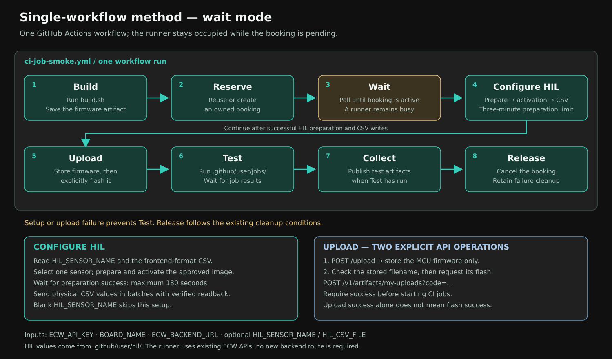

# Wait mode (the default pipeline)

`ci-job-smoke.yml` is the default pipeline in this template. One workflow
runs eight jobs; the third, `Wait`, sits and **polls** the ECW backend until
your booked slot starts. That is what "wait mode" means, as opposed to
[trigger mode](07-trigger-mode.md),
where ECW wakes a second workflow itself.

If you have not run it yet, start with
[docs/01-getting-started.md](01-getting-started.md). This page explains what
you will see and why it behaves the way it does.



For comparison, see the [two-stage method diagram](diagrams/two-stage-method.svg)
and [its setup guide](07-trigger-mode.md).

## The eight jobs

```
Build -> Reserve -> Wait -> Configure HIL -> Upload -> Test -> Collect -> Release
```

Each job starts only after the previous one succeeds (except `Collect` and
`Release`, which are built to still run after a failure).

| Job | Script or step | What it does | Fails when |
| --- | --- | --- | --- |
| `Build` | `.github/user/build/build.sh` | Compiles your firmware and uploads `build/` as artifact `ecw-firmware-<run-id>`. | `build.sh` is missing, not executable, or exits non-zero. |
| `Reserve` | `select_board.py`, `find_or_create_booking.py` | Checks the secrets, variable and backend health, resolves `BOARD_NAME` to a board type, then reuses your closest existing booking for that board or creates one with `POST /auto-bookings`. Publishes the booking id to later jobs. | `ECW_API_KEY` or `BOARD_NAME` missing, backend unreachable, no matching board type, no free slot. |
| `Wait` | `wait_for_booking.py` | Polls `GET /booking` every few seconds until the booking's window has started and its status is `active`. | The booking ends before it ever became active, or `ECW_BOOKING_WAIT_TIMEOUT_SECONDS` runs out. |
| `Configure HIL` | `configure_hil.py` | Prepares the named HIL sensor, waits up to three minutes for preparation/activation success, then sends frontend-format CSV values. Blank sensor variable skips setup. | Invalid CSV/name, preparation or activation timeout, or failed value write. |
| `Upload` | `upload_and_flash.py` | Stores the single `.bin`, verifies its stored filename, then explicitly flashes it. | Missing/empty/multiple binaries, unsuccessful upload, or unsuccessful explicit flash. |
| `Test` | `create_jobs.py`, `poll_jobs.py`, `download_artifacts.py` | Creates one CI job per file in `.github/user/jobs/`, polls each to a terminal state, and downloads each job's logs and captured files. | Any CI job ends in a status other than `succeeded`. |
| `Collect` | `upload-artifact` | Uploads everything `Test` saved as artifact `ecw-ci-job-smoke-<run-id>`. Runs whether `Test` passed or failed, so you always get the evidence. | Rarely; only if there is nothing to upload. |
| `Release` | inline `curl` | Cancels the booking so the board is free for the next person. Runs even after an earlier failure, as long as `Reserve` succeeded. | The cancel call is rejected or the backend is unreachable. The job goes red, and the booking then stays reserved until its slot ends, so cancel it in the ECW frontend if you want the board back sooner. |

Because `Release` still runs after a failure, a failed run normally does not
leave the board locked until your slot would have ended (unless the cancel
call itself fails, see above).

## How a run is triggered

```yaml
on:
  pull_request:
    branches:
      - develop
      - main
  workflow_dispatch: {}

concurrency:
  group: ecw-ci-${{ github.workflow }}
  cancel-in-progress: false
```

- **Pull request** into a listed branch: opened, new commits pushed to it, or
  reopened. A plain push to a branch does not start a run. Change the
  `branches:` list to your own base branches; it is the only line in the
  workflow you are expected to edit.
- **Run workflow** button (Actions tab): always available.
- **Runs queue, they do not overlap.** Every run books, flashes and releases
  the same board, so two at once would race on that booking. `concurrency`
  makes the second wait for the first. It deliberately does not cancel the
  run in progress: cancelling would skip `Release` and leave the booking held.
- **Pull requests from forks** get no secrets from GitHub, so `Reserve`
  fails. Open the pull request from a branch in the same repository.

## What `Wait` actually costs

The `Wait` job holds a runner for as long as it polls. Its `timeout-minutes`
is 1440 (24 hours), matching how far ahead auto-booking searches for a free
slot. Two consequences:

- **GitHub-hosted runners** bill those minutes to your plan on private
  repositories.
- **Self-hosted runners** are tied up for the entire wait, so one queued
  booking can block other workflows on that machine.

If the board is usually free, this is negligible: the slot starts right away
and `Wait` finishes in seconds. If bookings queue for hours, use trigger mode
instead. It ends `Stage 1` as soon as the booking is reserved and lets ECW
start `Stage 2`.

## Timeouts you can tune

Set these as repository **variables** (see
[docs/02-secrets-and-variables.md](02-secrets-and-variables.md)):

| Variable | Default | Controls |
| --- | --- | --- |
| `ECW_BOOKING_WAIT_TIMEOUT_SECONDS` | `86400` | How long `Wait` polls before giving up. |
| `ECW_JOB_WAIT_TIMEOUT_SECONDS` | `180` | How long `Test` polls any single CI job. |

## Which booking does it use?

`Reserve` prefers reuse over creating a new booking on every run. It lists
your non-cancelled bookings whose end has not passed, ordered by start time,
and takes the first one that matches `BOARD_NAME`. A booking that is active
right now sorts ahead of a future one, so you keep working against the board
you already hold.

Practical consequences:

- Two workflow runs against the same board **share one booking**. Do not run
  them at the same time, or their `Configure HIL`, `Upload`, `Test` and `Release` jobs will
  race each other.
- If you want a clean slate, cancel the existing booking in the ECW frontend
  (or let `Release` do it) and rerun.

## Reading the results

Open the run and scroll to **Artifacts**:

| Artifact | Contains |
| --- | --- |
| `ecw-firmware-<run-id>` | The `build/` directory, including the `.bin` that was flashed. |
| `ecw-hil-<run-id>` | `hil-configuration.json`: selected sensor, CSV filename, sample/word counts, preparation result and sent-word count, including failures. |
| `ecw-ci-reserve-<run-id>` | `booking.json` (which booking was used) and `board-types.json` (the board types the backend returned). |
| `ecw-ci-job-smoke-<run-id>` | Per-job logs, results and summaries, plus every file the jobs captured (serial logs, camera photos). |

For the Arduino demo, what a healthy result looks like is spelled out in
[docs/08-arduino-demo.md](08-arduino-demo.md).

## Common failures at a glance

| Symptom | Where to look |
| --- | --- |
| Red `Build` | Run `build.sh` locally; check it is executable and leaves one `.bin`. |
| Red `Reserve` | Secret/variable names (step 4 and 5 of getting started), then the `401`/`403`/`404` notes in the troubleshooting table there. |
| `Wait` never finishes | Someone else holds the board. Look at `booking.json` in the reserve artifact for the start time. |
| Red `Configure HIL` | Open `ecw-hil-<run-id>`. Check the sensor name, CSV and existing preparation API; firmware upload and tests do not start after failure. |
| Red `Upload` | Check whether storage upload failed or the following explicit flash failed; both happen inside Upload. |
| Red `Test` | Open `ecw-ci-job-smoke-<run-id>`; each failed job has its own log and result file. |

The full troubleshooting table is in
[docs/01-getting-started.md](01-getting-started.md#troubleshooting).
